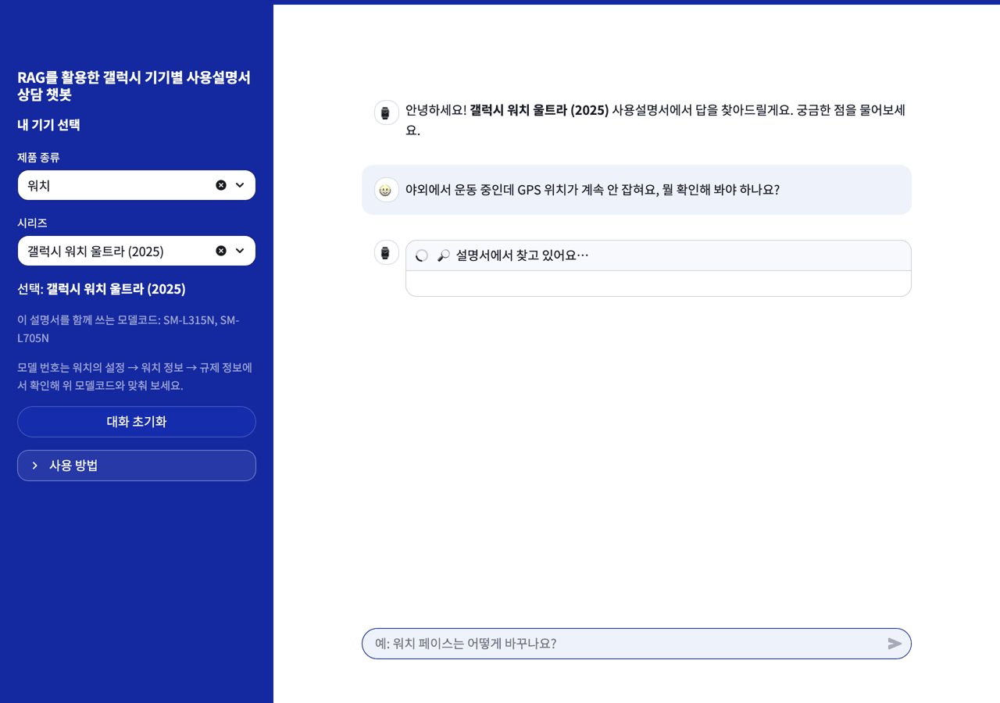
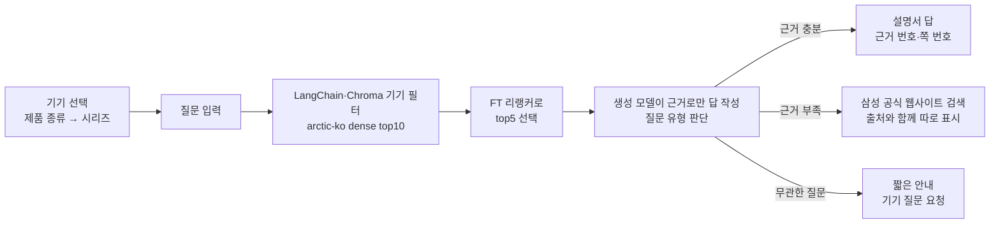
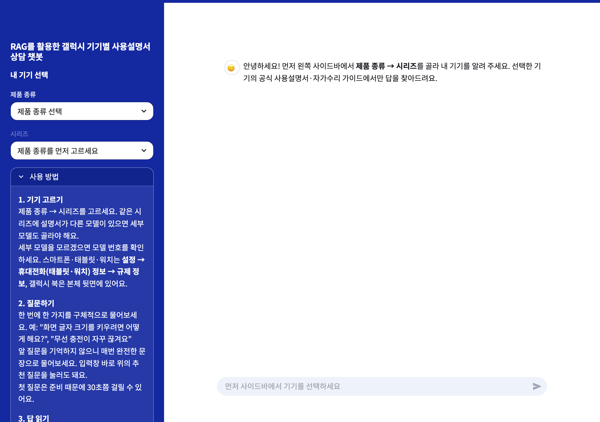
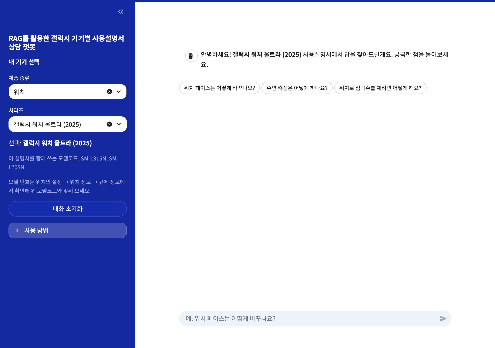
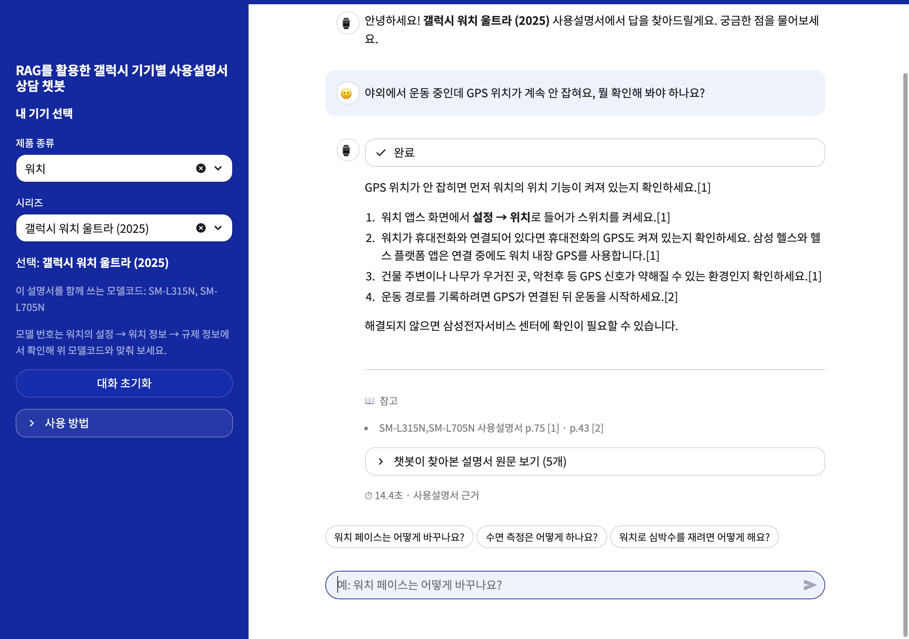
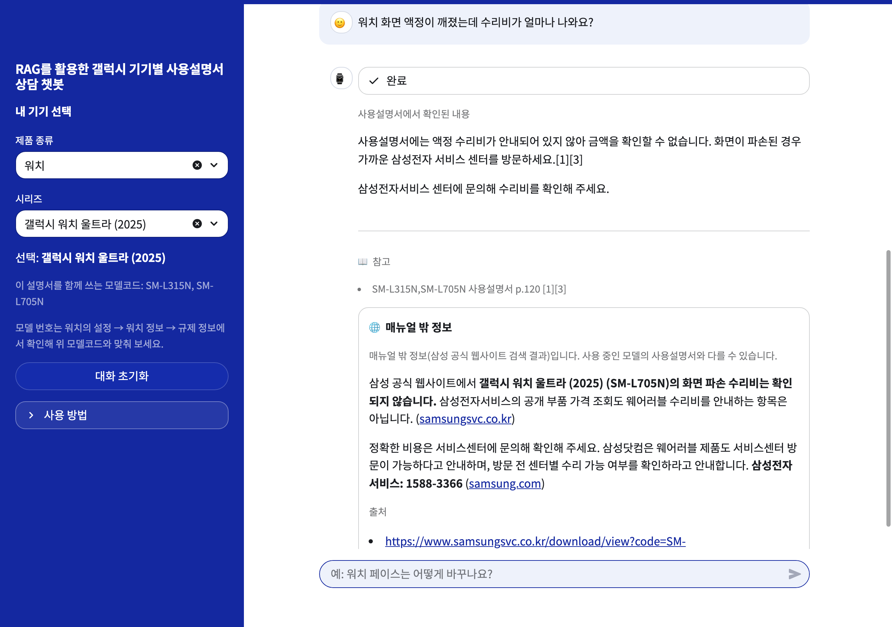
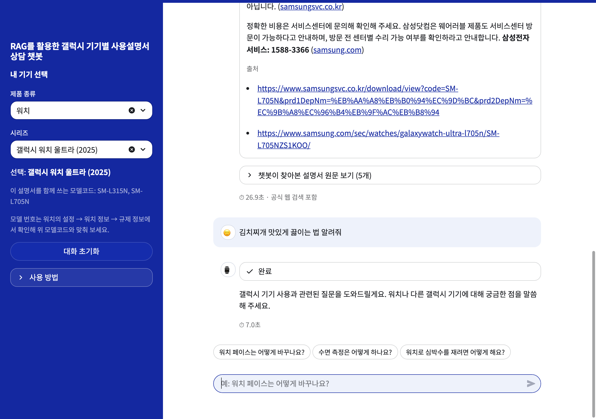

# RAG를 활용한 갤럭시 기기별 사용설명서 상담 챗봇




---

## 프로젝트 배경과 목표

갤럭시 사용법을 안내하려면 질문과 관련된 문장을 찾는 데 더해, 그 내용이 사용자의 기기에 적용되는지 구분해야 한다. 여러 기기가 함께 쓰는 공용 설명서가 있고, 서로 다른 기기의 설명서에도 유사한 내용이 반복된다. 검색 결과가 관련 있어 보여도 기기가 다를 수 있으며, 필요한 근거를 놓치면 설명서에 있는 내용도 답변으로 연결하기 어렵다.

이 프로젝트는 **사용자 질문을 해당 기기에 맞는 설명서 근거에 연결하는 것**을 목표로 삼았다. 기기별 검색 범위를 구성하고, 그 안에서 필요한 근거를 찾는 검색 방식을 비교했다. 찾은 근거는 답변과 설명서 쪽수로 함께 제시하고, 설명서에서 확인하지 못한 내용은 공식 웹 검색 결과로 구분해 제공하도록 구현했다.

---

## 동작 흐름



---

## 데이터

* 문서: 삼성전자 공식 한국어 사용설명서 56개, 자가수리 가이드 64개
* 전처리: PDF 텍스트 추출 후 쪽·절 단위 청크 **13,218개**로 분할
* 기기: 모델코드 201개를 같은 설명서 기준 **103개 묶음**으로 정리
* 평가 질문 289개: 설명서로 답할 수 있는 질문 154, 답이 없는 질문 97, 무관한 질문 20, 다른 회사 이름이 든 갤럭시 질문 9, 경계 질문(가격·출시일 등) 9
  * 설명서로 답할 수 있는 질문과 답이 없는 질문은 삼성전자서비스 FAQ 기반으로 구성

---

## 모델 및 기술 스택

* **LLM**: gpt-6-luna(답 생성), gpt-5.4-mini(LLM judge)
* **임베딩**: dragonkue/snowflake-arctic-embed-l-v2.0-ko(arctic-ko)
* **리랭커**: BAAI/bge-reranker-v2-m3 (FT)
* **검색**: LangChain, Chroma, rank-bm25 + kiwipiepy
* **평가**: RAGAS(검색), LLM judge(답변)
* **웹 검색**: OpenAI Responses API web_search
* **UI / 외부 연결**: Streamlit / MCP 서버
* **파이썬 라이브러리**: langchain, chromadb, ragas, sentence-transformers, transformers, torch, rank-bm25, kiwipiepy, PyMuPDF, openai, streamlit, mcp

---

## 검색 구성 비교

* 임베딩: bge-m3, KURE-v1, arctic-ko
  * 한국어 임베딩 리더보드 검색 점수 상위 모델과 기본 모델(bge-m3)을 후보로 선택
* 검색 방식: BM25, dense, hybrid(RRF, 같은 가중치·튜닝 안 함), 기성 리랭커, FT 리랭커
  * FT 리랭커는 평가 질문의 질문–청크 판정 데이터로 임베딩마다 그 임베딩의 검색 후보에서 학습, 수치는 그 질문을 학습에서 뺀 OOF 모델로 측정
* 13개 후보를 질문 150개로 비교, 주 지표 **R@5**(질문별 정답 청크 중 top5에 든 비율의 평균)
  * 답 생성에 top5만 넣고 질문마다 정답 청크가 여러 개여서 정답을 모두 찾는지 보는 지표로 선택
  * 정답 청크: 후보 top10 3,043쌍을 LLM 2개가 따로 판정(Cohen κ 0.94), 갈린 27쌍은 사람이 판정

| 임베딩 | 검색 방식 | R@1 | R@3 | **R@5** | hit@5 | MRR@10 |
|---|---|---|---|---|---|---|
| — | BM25 | 0.324 | 0.552 | **0.637** | 0.733 | 0.563 |
| bge-m3 | dense | 0.407 | 0.649 | **0.762** | 0.880 | 0.708 |
| KURE-v1 | dense | 0.392 | 0.683 | **0.776** | 0.900 | 0.701 |
| arctic-ko | dense | 0.442 | 0.751 | **0.863** | 0.947 | 0.751 |
| bge-m3 | hybrid | 0.438 | 0.666 | **0.764** | 0.867 | 0.711 |
| KURE-v1 | hybrid | 0.443 | 0.686 | **0.787** | 0.880 | 0.716 |
| arctic-ko | hybrid | 0.433 | 0.699 | **0.803** | 0.880 | 0.722 |
| bge-m3 | 기성 리랭커 | 0.504 | 0.735 | **0.815** | 0.920 | 0.785 |
| KURE-v1 | 기성 리랭커 | 0.509 | 0.745 | **0.837** | 0.933 | 0.786 |
| arctic-ko | 기성 리랭커 | 0.512 | 0.777 | **0.874** | 0.940 | 0.801 |
| bge-m3 | FT 리랭커 | 0.574 | 0.806 | **0.866** | 0.960 | 0.863 |
| KURE-v1 | FT 리랭커 | 0.565 | 0.813 | **0.879** | 0.973 | 0.866 |
| **arctic-ko** | **FT 리랭커 (최종)** | 0.612 | 0.830 | **0.909** | 0.967 | 0.892 |

* 주 지표 R@5 포함 **4개 지표 1위**인 arctic-ko + FT 리랭커를 최종 선택
* 2위권과 차이는 작음: KURE-v1 + FT 리랭커와 R@5 차이 +0.030 [−0.011, +0.071]로 CI가 0 포함
  * 점검 5가지 중 4가지에서 R@5 1위, 나머지 1가지(질문 89개 부분집합)에서는 arctic-ko 기성 리랭커가 1위(0.938 vs 0.934)

---

## 기기 필터 효과

같은 154문항을 최종 검색 구성으로 찾되, 기기 필터 대신 품목(폰·탭 등) 필터만 걸어 비교

| 조건 | top5 청크 중 다른 모델 설명서 | 1위 청크가 다른 모델인 문항 |
|---|---|---|
| 기기 필터 off | 770개 중 647개 (**84.0%**) | 154개 중 128개 (**83.1%**) |
| 기기 필터 on | 770개 중 0개 | 154개 중 0개 |

* 품목별 다른 모델 설명서 비율(필터 off): 탭 92.2%, 폰 89.4%, 북 89.3%, 워치 82.8%, 버즈 61.6%
* 다른 모델 청크 647개 중 고른 기기 설명서에도 같은 문장이 있는 비율은 **23.2%**. 내용은 맞고 기기 귀속만 다른 경우
* LangChain FAISS 기본 설정(후보 20개 검색 후 필터): 154문항 중 128문항이 결과 5개 미만, R@5 **0.514** → 검색 안에서 필터: **0.863** ([Patel et al., 2024](https://arxiv.org/abs/2403.04871); [Weaviate, 2024](https://weaviate.io/blog/speed-up-filtered-vector-search); [LangChain #28413](https://github.com/langchain-ai/langchain/issues/28413))

---

## 답변 지침 구성

| 블록 | 내용 |
|---|---|
| 근거 사용 | 검색된 top5 청크만 사용, 사실 문장마다 근거 번호 [1], [2] |
| 근거 충분 여부 판단 | 질문의 핵심이 근거에 없으면 "사용설명서에서 확인하지 못했다"고 밝히고 웹 검색으로 전환 |
| 범위 밖 질문 | 범위 밖이면 내용에 답하지 않고 응대 |
| 기기 일치 | 다른 모델 한정 설명 제외 |

---

## 시연 예시

화면 속 소요 시간은 캡처할 때의 값임

**1. 첫 화면**: 사이드바에서 제품 종류 → 시리즈 선택 안내, 사용 방법 펼쳐 보기



**2. 기기 선택**: 워치 → 갤럭시 워치 울트라 (2025) 선택 시 같은 설명서를 쓰는 모델코드와 추천 질문 표시



**3. 설명서 답**: GPS 문제 해결 질문에 근거 번호가 붙은 번호 목록과 설명서 쪽 번호 표시



**4. 설명서 밖 질문**: 수리비는 설명서에 없다고 밝히고 공식 웹사이트 검색 결과를 출처와 함께 따로 표시



**5. 무관한 질문**: 김치찌개 끓이는 법 질문에 내용 답변 없이 기기 질문 요청



---

## 성능 평가

| 항목 | 결과 |
|---|---|
| 필수 사실 포함률(154문항, LLM judge) | **0.861** [0.816, 0.904] |
| 답이 있는데 웹으로 잘못 넘김 | 154개 중 14개 |
| 답이 없는데 웹으로 넘기지 못함 | 97개 중 5개 |
| 정상 질문을 무관한 질문으로 잘못 거름 | **260개 중 0개** |
| 무관한 질문에 답함 | **20개 중 3개** |
| 설명서에 없는 주장이 든 답(사람, 답 40개) | 0개 |
| LLM judge와 사람 판정 일치(필수 사실 65개) | 92.3%, Cohen κ 0.636 [0.17, 0.90] |

* 95% CI는 질문 단위 bootstrap

---

## 한계점

* **지원 범위:** 한 번에 기기 1개, 질문마다 독립 처리(앞 대화 미연결)
* **평가 수치가 실제보다 높을 가능성**
  * 검색 조합과 지침을 고른 154문항으로 성능도 보고
  * R@5 0.909는 판정한 후보 안의 정답 기준(대략 보정 시 0.641, 가장 나쁘게 잡으면 0.200), 후보 간 순위 비교에는 영향 없음
* **사람 판정 범위:** 판정자는 작성자 1명
* **평가 조건과 실제 앱의 차이:** 평가 때는 웹 검색을 끄고 답을 1번씩 생성, 웹 검색 후 답 품질은 미평가, 리랭커는 평가 때 OOF 모델·앱은 전체 학습본

---

## 확장: MCP 서버

같은 검색 엔진을 다른 AI 앱이 도구로 불러 쓰도록 MCP 서버로 구현, 답변은 연결한 AI 앱이 생성

| 도구 | 하는 일 |
|---|---|
| `find_device` | 기기 이름·모델코드로 설명서가 있는 기기 찾기 |
| `search_manual` | 고른 기기 설명서에서 챗봇과 같은 경로로 근거 찾기 |
| `search_official_web` | 삼성 공식 웹사이트 검색 결과를 출처와 함께 반환 |

* 터미널 데모([`demo.py`](code/mcp_server/demo.py))로 도구 호출부터 근거 번호가 붙은 답까지 확인
* ChatGPT 앱·claude.ai 커넥터는 **미연결**, MCP 경로 답변 품질은 **미평가**

---

## 실행 방법

* **공개 범위:** 코드와 노트북에 저장된 집계 결과 열람용
* **실행 조건:** 앱·MCP 실행에 필요한 로컬 카탈로그·manifest·추천 질문 및 평가 자료·검색 인덱스·FT 리랭커 가중치는 미포함. 해당 자산 별도 준비 필요

```bash
cd code    # 로컬 data/와 .env(OPENAI_API_KEY)를 이 폴더에 둠
python3 -m venv .venv
.venv/bin/python3 -m pip install -r requirements.txt -r requirements-app.txt
.venv/bin/python3 scripts/build_chroma_index.py    # 처음 한 번, Chroma 색인 생성
.venv/bin/python3 -m streamlit run app/main.py --server.address 127.0.0.1
```

* **노트북:** `code/`에서 `python -m pip install -r requirements-notebooks.txt` 실행 후, VS Code에서 `notebooks/`를 번호 순서로 열고 설치한 Python 환경을 커널로 선택. 집계표·그래프는 노트북에 포함하며 별도 결과 파일 불필요. 기본 실행은 저장된 집계 확인, 실제 문서 처리·학습은 별도 로컬 자료 필요

* **MCP:** Python 3.10 이상 별도 환경에 기본 의존성과 `requirements-mcp.txt` 설치 후 `python mcp_server/server.py` 실행. 대화 데모는 `python mcp_server/demo.py`

```text
code/
├── notebooks/                 데이터 준비·검색 비교·FT 학습·답변 평가
├── app/                       챗봇 화면, main.py로 실행
├── mcp_server/                서버 server.py, 데모 demo.py
├── rag/                       자료 처리·검색·답변·평가 공용 코드
├── scripts/                   Chroma 색인 생성, RAGAS R@5 계산, 기기 필터 방식 비교
├── tests/                     앱·답변·스트리밍 시험
└── requirements*.txt
figs/                          시연 화면
```

---

## 데이터·저작권 안내

* 제조사 설명서 원문·청크·리랭커 가중치·평가 라벨(`data/`)은 저장소에 미포함
* 앱 실행에는 로컬 데이터와 OpenAI API 키 필요. 노트북의 저장 결과 확인에는 API 키 불필요
* 웹 호스팅 없이 로컬 실행 전용
